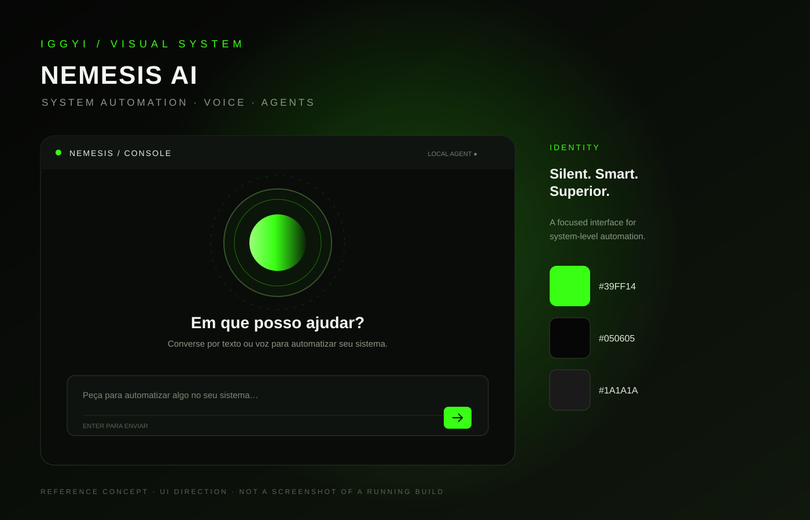

# NEMESIS AI — System Automation

> Assistente local-first para automação de sistemas, com conversa por texto e voz, API NVIDIA, n8n e agentes por sistema operacional. Identidade visual IGGYI: preto e verde neon `#39FF14`.

## Estado do projeto

Este repositório começa com um MVP funcional de interface e backend. A integração de voz usa APIs de fala do navegador quando disponíveis; o agente de sistema expõe apenas ações explicitamente permitidas. Não é uma ferramenta de pentest.

## Referências visuais

### Identidade IGGYI e conceito da interface



### Arquitetura planejada


> Estas imagens são referências conceituais para orientar o desenvolvimento; não representam capturas de tela de uma versão já executada.

## Arquitetura

- **Frontend:** React + Vite, chat responsivo, controles de voz e painel de tarefas.
- **Backend local:** FastAPI em Python.
- **IA:** NVIDIA API via endpoint compatível com OpenAI Chat Completions; modelo configurável por variável de ambiente.
- **Automação:** webhooks opcionais do n8n.
- **Agente:** adaptadores por SO; neste MVP, ações limitadas de consulta e volume Linux são disponibilizadas quando as ferramentas estão instaladas.
- **Segurança:** chave NVIDIA apenas no backend, lista de ferramentas permitidas, validação de argumentos e confirmação de ações sensíveis.

## Requisitos

- Python 3.11+
- Node.js 20+
- Chave de API NVIDIA NIM (opcional para abrir a interface; necessária para respostas de IA)
- Docker Compose, se quiser iniciar o n8n integrado

## Iniciar

### 1. Configurar backend

```bash
python -m venv .venv
# Linux/macOS:
source .venv/bin/activate
# Windows PowerShell:
# .venv\Scripts\Activate.ps1
pip install -r backend/requirements.txt
cp .env.example .env
```

Edite `.env` e defina `NVIDIA_API_KEY`. Escolha um modelo disponível na sua conta NVIDIA em https://build.nvidia.com/. O valor de `NVIDIA_MODEL` é configurável; valide disponibilidade e suporte a tool calling no catálogo atual.

Inicie o backend:

```bash
uvicorn backend.app:app --host 127.0.0.1 --port 8765
```

### 2. Iniciar frontend

Em outro terminal, na raiz:

```bash
npm install
npm run dev
```

Abra o endereço local informado pelo Vite. A interface usa `http://127.0.0.1:8765` como backend por padrão.

### 3. n8n opcional

```bash
docker compose up -d n8n
```

Abra http://127.0.0.1:5678 e configure um webhook. Adicione a URL ao campo `N8N_WEBHOOK_URL` no `.env` e reinicie o backend.

## Variáveis de ambiente

Veja `.env.example`. Nunca coloque chaves privadas no frontend nem as envie ao GitHub.

## Voz

O botão de microfone usa reconhecimento de fala disponível no navegador (Web Speech API) e a resposta pode ser lida com síntese de voz. O suporte varia por navegador e sistema operacional; para voz local/offline ou uso contínuo, será necessário instalar um motor STT/TTS específico.

## Ações do sistema e permissões

O agente não executa comandos arbitrários gerados pelo modelo. A versão inicial disponibiliza ferramentas permitidas e validadas. No Linux, o controle de volume tenta usar `wpctl` ou `pactl`; os comandos só funcionam se o sistema e as ferramentas suportarem. Não execute o backend exposto à internet sem autenticação, TLS e regras de acesso adequadas.

## Agentes para múltiplos sistemas

A estrutura prevê adaptadores separados para Linux, Windows e Android/Termux. O MVP não instala automaticamente agentes remotos nos outros dispositivos: cada agente futuro deverá ser instalado e pareado explicitamente, autenticado e autorizado pelo usuário.

## Desenvolvimento

```bash
npm run build
```

Licença ainda não definida. Adicione uma licença antes de redistribuir.
