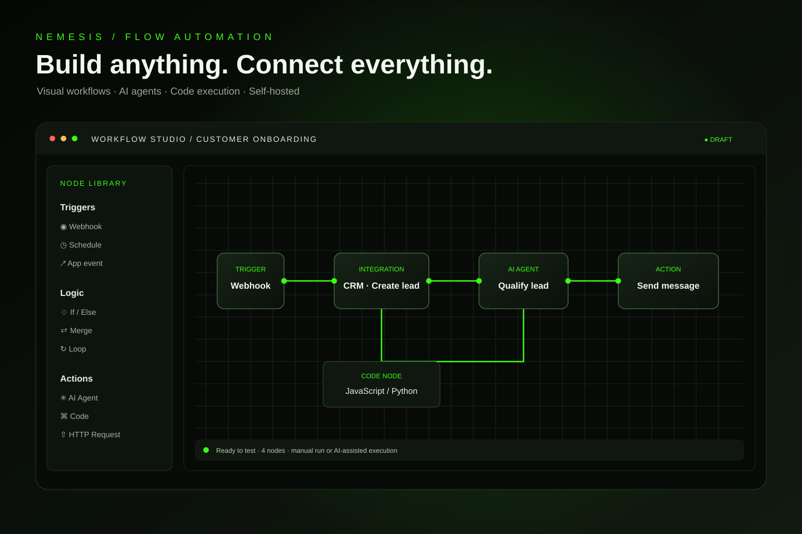
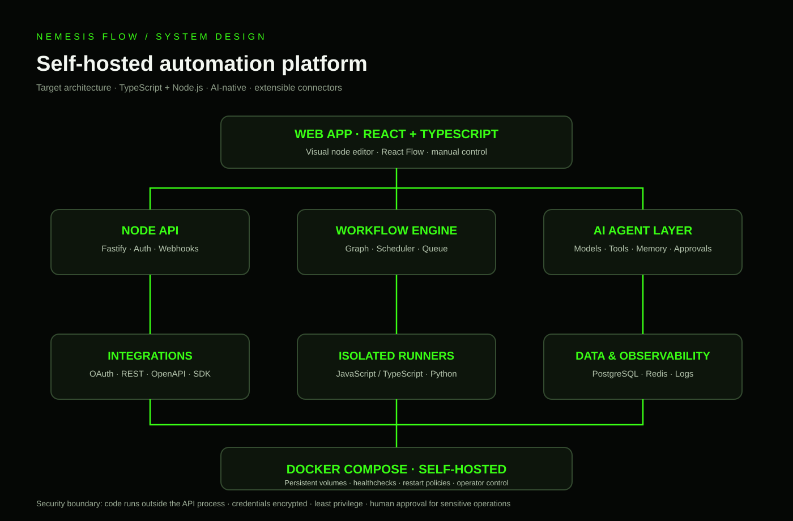

# NEMESIS FLOW

> Plataforma open source de automação visual, extensível e self-hosted. Crie workflows conectando APIs, serviços, código personalizado e agentes de IA — com controle local dos dados e execução via Docker.

**NEMESIS FLOW é o novo direcionamento deste repositório.** A base atual ainda é um MVP de assistente React + FastAPI com integração opcional ao n8n. A migração para o motor de automação TypeScript/Node.js e o editor visual descritos abaixo é o plano de evolução; recursos planejados não devem ser confundidos com funcionalidades já entregues.

## Visão do produto

O objetivo é oferecer uma alternativa aberta ao Zapier, n8n e Make, combinando facilidade no-code com liberdade para desenvolvedores:

- Editor visual baseado em nós, conexões e portas tipadas.
- Workflows com gatilhos, condições, ramificações, loops, espera, transformação e tratamento de erros.
- Catálogo extensível de integrações, com centenas de conectores como meta — não um número já implementado.
- Autenticação por API key, OAuth 2.0, webhooks e credenciais armazenadas com segurança.
- Etapas de código JavaScript/TypeScript e Python.
- Agentes de IA com ferramentas, memória, contexto, chamadas de modelos e saídas estruturadas.
- Execução manual, por agenda, webhook, evento ou decisão autorizada de um agente.
- Histórico de execuções, logs por nó, repetição, cancelamento e inspeção de dados.
- Instalação self-hosted com Docker Compose e volumes persistentes.

## Direção visual

*Conceito visual da experiência desejada; não é uma captura de tela de uma versão já implementada.*

## Arquitetura-alvo

### Stack proposta

| Camada | Tecnologia | Responsabilidade |
| --- | --- | --- |
| Interface | React + TypeScript | Aplicação web e editor visual |
| Canvas | React Flow (@xyflow/react) | Nós, portas, conexões e viewport |
| API | Node.js + TypeScript + Fastify | API, autenticação e gerenciamento |
| Workflow engine | TypeScript | Validação, orquestração e execução |
| Jobs | Redis + BullMQ (opcional no modo simples) | Filas, concorrência, retries e agendamento |
| Dados | PostgreSQL; SQLite para instalação simples/local | Workflows, credenciais, execuções e configurações |
| Integrações | SDK de conectores + OpenAPI | Adaptadores de serviços e APIs |
| IA | Camada provider-agnostic | NVIDIA, OpenAI, Anthropic, Google e modelos compatíveis |
| Python | Worker isolado | Execução de etapas Python |
| Deploy | Docker Compose | Serviços, volumes e inicialização |

A arquitetura deve permitir iniciar pequeno e crescer: modo local com menos dependências e modo servidor com banco/filas dedicados.

## Editor de workflows

Cada workflow é um grafo versionado. Um nó recebe dados de entrada, valida sua configuração, executa uma operação e publica saídas tipadas para os próximos nós.

### Nós essenciais

- **Triggers:** Manual, Webhook, Schedule/Cron e eventos de integração.
- **Flow control:** If/Else, Switch, Merge, Loop, Wait e Stop.
- **Data:** Set, Map, Filter, JSON, validação e transformação.
- **Integrations:** ações e gatilhos dos serviços conectados.
- **AI:** LLM, agente, classificador, extração estruturada e aprovação humana.
- **Code:** JavaScript/TypeScript e Python.
- **Operations:** HTTP Request, logs, notificações e tratamento de falhas.

O editor deve suportar autosave, validação do grafo, execução de teste, visualização de payloads e depuração nó a nó.

## Biblioteca de integrações

A biblioteca será modular: cada conector declara identidade, credenciais, triggers, actions, schemas de entrada/saída e documentação. A meta é chegar a centenas de integrações sem acoplar o motor a fornecedores específicos.

Prioridades: HTTP/REST, Webhooks, e-mail, Discord, Slack, Telegram, GitHub, Google Workspace, Notion, bancos de dados, storage, pagamentos e ferramentas de IA. OpenAPI deve permitir importar APIs próprias e gerar operações a partir de especificações.

Conectores comunitários devem ser instaláveis e versionados. Credenciais ficam separadas das definições de workflow e nunca são exportadas em texto puro.

## Código personalizado e isolamento

Usuários técnicos poderão inserir JavaScript/TypeScript ou Python como etapas do fluxo. Código de workflow é código não confiável: **não deve ser executado diretamente no processo da API**.

A implementação deve usar workers isolados, limites de CPU/memória/tempo, diretório temporário, rede desabilitada por padrão, allowlists configuráveis e encerramento de processos. Segredos só devem ser injetados no contexto estritamente necessário e mascarados nos logs. O modo de execução privilegiado deve exigir configuração e aprovação explícitas.

## Agentes de IA

Agentes serão nós de primeira classe no editor. Um agente poderá receber objetivo e contexto, selecionar ferramentas permitidas, produzir saídas estruturadas e solicitar aprovação antes de ações sensíveis.

O usuário poderá escolher entre execução manual e execução assistida por IA. A IA poderá criar, testar, iniciar, pausar ou solicitar alterações em workflows conforme as permissões concedidas. A IA não ganha acesso irrestrito ao host, ao shell ou ao daemon Docker.

## Docker: iniciar automaticamente e continuar sob controle

O Compose atual deste repositório contém apenas o serviço opcional n8n. Ele usa a política de reinício unless-stopped, que reinicia o container após reinicializações do Docker daemon, desde que o container tenha sido criado e não tenha sido parado manualmente. **Isso não instala nem habilita o Docker daemon no sistema operacional.**

### Linux (systemd)

Habilite o daemon para iniciar com o sistema:

~~~bash
sudo systemctl enable --now docker
~~~

Na raiz do repositório, suba os serviços definidos no Compose:

~~~bash
docker compose up -d
docker compose ps
~~~

Controle manual:

~~~bash
docker compose stop
docker compose start
docker compose restart
docker compose logs -f
docker compose down
~~~

No Docker Desktop, habilite **Start Docker Desktop when you sign in** nas configurações. A política unless-stopped mantém o reinício automático dos containers depois que o Docker estiver disponível.

### Controle por IA

O controle por IA deve passar pela API de gerenciamento do NEMESIS, com autenticação, escopos e trilha de auditoria. A IA poderá operar workflows e serviços explicitamente autorizados. Operações de infraestrutura (por exemplo, parar containers ou alterar volumes) exigem permissão separada e confirmação humana por padrão. O controle manual permanece disponível a qualquer momento.

## Instalação e estado atual

### O que existe hoje

- Interface React/Vite.
- Backend local FastAPI em Python.
- Integração configurável com NVIDIA API.
- Ferramentas locais limitadas e explícitas.
- Serviço n8n opcional no docker-compose.yml.

### O que ainda está planejado

- Motor de workflows TypeScript/Node.js.
- Editor de nós React Flow.
- Catálogo amplo de integrações nativas.
- Workers isolados para JavaScript e Python.
- Orquestração nativa de agentes.
- Persistência e filas para execução em produção.
- Stack Docker completa do NEMESIS FLOW.

A documentação descreve a direção do produto, não afirma que esses componentes já estejam disponíveis.

### Executar a base atual (MVP)

Requisitos: Python 3.11+, Node.js 20+ e npm.

~~~bash
git clone https://github.com/stylesxzz/Nemesis.git
cd Nemesis
python3 -m venv .venv
source .venv/bin/activate
python -m pip install -r backend/requirements.txt
cp .env.example .env
npm install
~~~

Configure NVIDIA_API_KEY no .env. Em dois terminais:

~~~bash
# Terminal 1
source .venv/bin/activate
uvicorn backend.app:app --host 127.0.0.1 --port 8765

# Terminal 2
npm run dev
~~~

A interface Vite normalmente estará em http://127.0.0.1:5173.

### n8n opcional na base atual

~~~bash
docker compose up -d n8n
~~~

Acesse http://127.0.0.1:5678. Configure N8N_WEBHOOK_URL no .env para permitir que o backend atual encaminhe tarefas ao webhook escolhido.

## Segurança e privacidade

- Self-hosted por padrão: dados e credenciais permanecem na infraestrutura do operador.
- Não exponha APIs, editor, banco ou n8n à internet sem autenticação, TLS e política de rede.
- Criptografe credenciais em repouso usando uma chave fornecida pelo operador.
- Aplique permissões por ação, auditoria e mascaramento de segredos.
- Isole cada execução de código; nunca avalie código arbitrário dentro do servidor principal.
- Use allowlists para conexões de saída e proteção contra SSRF.
- Defina limites de execução, payload, concorrência e retenção de logs.
- Ações destrutivas ou privilegiadas devem exigir aprovação explícita.

## Roadmap de desenvolvimento

1. **Fundação:** monorepo TypeScript, contratos de workflow, schemas, armazenamento e API.
2. **Editor:** canvas visual, nós básicos, conexões, validação e salvamento.
3. **Runtime:** execução determinística, fila, retries, cancelamento e histórico.
4. **Integrações:** SDK de conectores, OAuth, webhooks e importação OpenAPI.
5. **Código seguro:** workers isolados JavaScript/Python e políticas de recursos.
6. **IA:** nós de LLM/agente, ferramentas, memória e aprovações.
7. **Self-hosting:** Compose completo, migrações, backups, healthchecks e atualização.

## Contribuição

Contribuições são bem-vindas. Antes de adicionar um conector, documente autenticação, permissões, schemas, limites da API e exemplos de uso. Não envie tokens, arquivos .env ou dados reais de clientes.

## Licença

MIT. Consulte [LICENSE](LICENSE). Dependências e conectores de terceiros podem ter licenças próprias.
