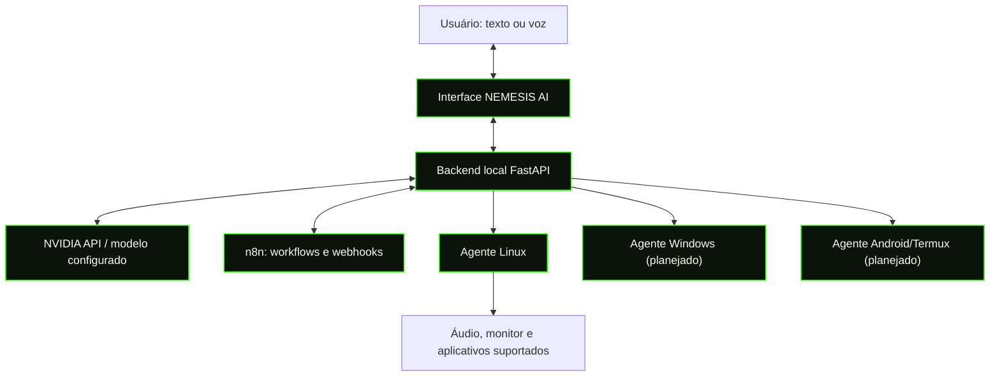

# NEMESIS AI — Automação de Sistemas

> Assistente local-first para automação de sistemas, conversa por texto e voz, NVIDIA API e n8n. Identidade visual IGGYI: preto e verde neon `#39FF14`.

[](LICENSE)

## Estado do projeto

MVP em desenvolvimento com interface React, backend FastAPI e integração NVIDIA configurável. A voz usa recursos do navegador quando disponíveis. As ações do sistema são limitadas às ferramentas permitidas pelo backend; não executa comandos de terminal arbitrários. Este projeto é para automação de sistemas, não para pentest.

## Diagrama da arquitetura

Se a imagem SVG não carregar no visualizador, o diagrama Mermaid abaixo funciona diretamente no GitHub:



### Referências visuais

- [Conceito visual IGGYI (SVG)](docs/images/iggyi-nemesis-brand-reference.svg)
- [Diagrama de arquitetura (SVG)](docs/images/nemesis-architecture.svg)

As imagens são referências conceituais, não capturas de tela de um produto finalizado.

## Requisitos

- Python 3.11 ou mais recente
- Node.js 20 ou mais recente (inclui npm)
- Chave NVIDIA API: necessária para respostas da IA
- Docker Compose: opcional, apenas para executar o n8n

## Instalação rápida — Linux

Execute os comandos abaixo **na raiz do repositório**:

```bash
# 1. Criar e ativar ambiente Python
python3 -m venv .venv
source .venv/bin/activate

# 2. Instalar backend e criar arquivo de configuração
python -m pip install -r backend/requirements.txt
cp .env.example .env

# 3. Instalar dependências do frontend
npm install
```

Abra o arquivo `.env` em um editor de texto e preencha `NVIDIA_API_KEY` com sua chave privada. Obtenha uma chave no [NVIDIA Build](https://build.nvidia.com/). O modelo configurado em `NVIDIA_MODEL` pode precisar ser alterado para um modelo habilitado na sua conta.

### Iniciar o sistema

Abra **dois terminais** na pasta do projeto.

**Terminal 1 — backend:**

```bash
source .venv/bin/activate
uvicorn backend.app:app --host 127.0.0.1 --port 8765
```

**Terminal 2 — interface:**

```bash
npm run dev
```

Abra o endereço local que o Vite mostrar no terminal (normalmente http://127.0.0.1:5173).

### Windows (PowerShell)

Na raiz do projeto, crie o ambiente e instale as dependências:

```powershell
py -3 -m venv .venv
.\.venv\Scripts\Activate.ps1
python -m pip install -r backend/requirements.txt
Copy-Item .env.example .env
npm install
```

Edite `.env` e configure `NVIDIA_API_KEY`. Inicie o backend num terminal:

```powershell
.\.venv\Scripts\Activate.ps1
uvicorn backend.app:app --host 127.0.0.1 --port 8765
```

Num segundo terminal, execute `npm run dev` e abra o endereço mostrado.

## n8n opcional

Se o Docker estiver instalado e em execução:

```bash
docker compose up -d n8n
```

Acesse http://127.0.0.1:5678, crie um workflow com nó Webhook e configure a URL de produção/teste em `N8N_WEBHOOK_URL` no arquivo `.env`. Reinicie o backend após alterar o arquivo.

## Voz

O microfone usa reconhecimento de fala disponível no navegador (Web Speech API), e a resposta pode ser lida com síntese de voz. O suporte depende do navegador e do sistema. Voz offline ou contínua pode exigir motores STT/TTS adicionais.

## Controle do sistema e segurança

- A chave NVIDIA fica no backend, nunca no frontend.
- O backend deve permanecer ligado a `127.0.0.1` durante o uso local.
- O agente não deve executar texto arbitrário como comando shell.
- No Linux, o controle de volume depende da disponibilidade de `wpctl` ou `pactl`.
- Antes de habilitar ações sensíveis, configure permissões explícitas e confirmação do usuário.
- Não exponha o backend ou o n8n diretamente à internet sem autenticação, TLS e controles de acesso.
- Os agentes Windows e Android/Termux são planejados; não são instalados automaticamente por este MVP.

## Verificação de build

```bash
npm run build
```

## Licença

Este projeto é distribuído sob a licença MIT. Leia o arquivo [LICENSE](LICENSE). Dependências de terceiros mantêm suas próprias licenças.
